<!-- CHROME//DISTRICT · generated by generate.py · edit config.json and re-run -->

  <picture>
    <source media="(max-width: 600px)" srcset="assets/hero-m.svg"/>
    
  </picture>

  <samp>&gt; 5+ years turning manual work into reliable code: backends, data pipelines, AI.</samp> 
  <samp>&gt; status: open to software development &amp; data engineering roles</samp>

  <picture>
    <source media="(max-width: 600px) and (prefers-color-scheme: light)" srcset="assets/cyberware-m-light.svg"/>
    <source media="(max-width: 600px)" srcset="assets/cyberware-m.svg"/>
    <source media="(prefers-color-scheme: light)" srcset="assets/cyberware-light.svg"/>
    
  </picture>

  <picture>
    <source media="(max-width: 600px) and (prefers-color-scheme: light)" srcset="assets/gigs-m-light.svg"/>
    <source media="(max-width: 600px)" srcset="assets/gigs-m.svg"/>
    <source media="(prefers-color-scheme: light)" srcset="assets/gigs-light.svg"/>
    
  </picture>

  <picture>
    <source media="(max-width: 600px) and (prefers-color-scheme: light)" srcset="assets/missions-m-light.svg"/>
    <source media="(max-width: 600px)" srcset="assets/missions-m.svg"/>
    <source media="(prefers-color-scheme: light)" srcset="assets/missions-light.svg"/>
    
  </picture>

  <a href="https://ieeexplore.ieee.org/author/37089283025">
  <picture>
    <source media="(max-width: 600px) and (prefers-color-scheme: light)" srcset="assets/shard-m-light.svg"/>
    <source media="(max-width: 600px)" srcset="assets/shard-m.svg"/>
    <source media="(prefers-color-scheme: light)" srcset="assets/shard-light.svg"/>
    
  </picture>
  </a>

  <picture>
    <source media="(max-width: 600px) and (prefers-color-scheme: light)" srcset="assets/trophies-m-light.svg"/>
    <source media="(max-width: 600px)" srcset="assets/trophies-m.svg"/>
    <source media="(prefers-color-scheme: light)" srcset="assets/trophies-light.svg"/>
    
  </picture>

  <picture>
    <source media="(prefers-color-scheme: light)" srcset="assets/snake-light.svg"/>
    
  </picture>

  <picture>
    <source media="(max-width: 600px) and (prefers-color-scheme: light)" srcset="assets/footer-m-light.svg"/>
    <source media="(max-width: 600px)" srcset="assets/footer-m.svg"/>
    <source media="(prefers-color-scheme: light)" srcset="assets/footer-light.svg"/>
    
  </picture>

