<!-- CHROME//DISTRICT · generated by generate.py · edit config.json and re-run -->

  

  <samp>&gt; 5+ years turning manual work into reliable code: backends, data pipelines, AI.</samp> 
  <samp>&gt; currently_building: 5G small cells + AI platforms @ ACES R&amp;D</samp>

  

  

  
  
  

  

- <samp>[01]</samp> Intelligent Near-RT RIC xApp for 5G O-RAN Small Cells: Energy-Efficient PRB Optimization with E2 Control · *ISNCC 2026*
- <samp>[02]</samp> MORAN-Enabled O-RAN Split 7.2 Based 5G Indoor Small Cell Using srsRAN and a Custom RF Front End · *ISNCC 2026*
- <samp>[03]</samp> Encrypting and Predicting Medical Diagnosis Data · *IEMECON 2021*

<samp>[+]</samp> Named designer on **4 SAIP-registered 5G small-cell industrial designs** (SA 20766 · SA 20825 · SA 20864 · SA 21000)

  

  

